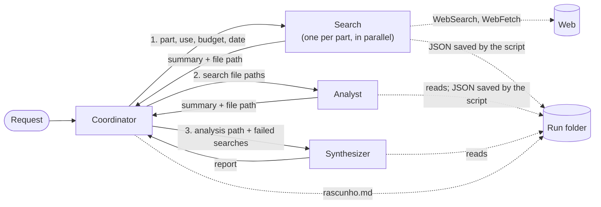

# Hardware research agents

A multi-agent researcher that compares PC parts and gives a source for every number.

You write what to compare and what for, for example *"RTX 5060 Ti 16 GB, RX 9060 XT 16 GB and RX 7700 XT 12 GB for 1440p gaming, budget R$ 3,500"*. A coordinator splits the work between search agents, an analyst and a synthesizer. The report shows what the sources agree on, what they dispute (every value, each with its source and date) and what is missing.

Built with the [Claude Agent SDK](https://github.com/anthropics/claude-agent-sdk-python) for Python, with Claude Haiku 5.5 in every agent. The reports are in Portuguese, with prices in Brazilian reais.

[Leia em português](README.pt-BR.md)

## How it works



- **Coordinator:** reads the request and calls one search per part, then the analyst, then the synthesizer. It can't use the web, and the only file it can touch is its scratchpad.
- **Search** (one per part, all at once): uses WebSearch and WebFetch and returns JSON findings, each with a claim, a quote, a URL and a publication date. It also lists gaps and returns a structured error when something fails.
- **Analyst:** reads the search files and puts each part and criterion in one group: confirmed, disputed or no data.
- **Synthesizer:** reads the analysis and writes the report.

Each research run gets its own folder:

```
rascunho.md          the coordinator's scratchpad: plan, files, failures
buscas/1-<part>.json what each search returned
analise.json         what the analyst returned
relatorio.md         the final report, with a coverage section
```

### Design decisions

- **Results travel through files, not through the conversation.** When the coordinator relayed JSON from one agent to the next, it dropped fields and quotes, even while saying it had copied everything. Now a hook saves each agent's answer to the run folder and replaces what the coordinator sees with one line: the path and a count of findings.
- **Code enforces the format.** A `SubagentStop` hook validates the JSON of the search and the analyst before they finish. It also rejects a criterion that is both confirmed and disputed. If the JSON is off, the agent gets the list of problems and one more try.
- **Hooks set the limits.** The coordinator can't search the web. Each search gets 3 web searches, 4 page fetches and 90 seconds. The coordinator only touches its scratchpad, and the other agents only read files in the run folder.
- **A failure doesn't stop the research.** A failed search returns what it found and a structured error, and the others keep going. The script writes the coverage section from what actually happened: timeouts, API errors, turn limits and the `error` field. That way the report doesn't depend on the model remembering to mention a failure.
- **The script checks what the model doesn't guarantee:** every link in the report came from a search, every dispute in the analysis reached the report, and each value's number appears in its quote.
- **The research reports events, and the terminal and the web page each show them their own way.**

Design notes in Portuguese: [docs/arquitetura.md](docs/arquitetura.md).

## The local web page

`tela.py` serves a page on `127.0.0.1` where you type the request and watch the agents work: the coordinator's steps, one card per search with the searches and pages it opens, blocked tools, then the analysis, the report, the cost and the checks. Closing the tab cancels the research. The server only listens on your machine, refuses requests from other sites and runs one research at a time.

## Results

**Example:** [exemplos/gpus-1440p](exemplos/gpus-1440p) has a full run comparing three graphics cards for 1440p, including the scratchpad, the three search files, the analysis and the [report](exemplos/gpus-1440p/relatorio.md).

**Citation check.** I opened every page cited in that report and looked for each value (16 citations):

| Result | Citations |
|---|---|
| The page exists and states the value | 13 of 16 (81%) |
| Could not be checked: the site didn't load (1), or the price came from an older version of the page, seen only in search results (2) | 3 of 16 |

The quotes are less literal than the values. Of the 13 confirmed values:
- 5 quotes are verbatim;
- 4 reformat the page layout but keep the number;
- 3 are paraphrased or translated;
- 1 quotes the right page but the wrong sentence: a memory size cited with a sentence about CUDA cores.

WebFetch passes each page through a model before the agent reads it, which explains most of the paraphrasing. The script's quote check flagged exactly that wrong sentence (15 of 16 passed). One more catch: one value is correct, but it comes from leaked benchmarks, and the report doesn't say so.

**Cost and time:** about US$ 0.11 to 0.15 per research with three parts, measured on four real runs, and 2 to 3 minutes with the searches in parallel. Each research has a US$ 0.60 budget cap.

## Run it

You need Python 3.10+ and your own Anthropic API key. Every research is billed to it.

```bash
git clone https://github.com/petrecaLeo/hardware-research-agents.git
cd hardware-research-agents
python -m venv .venv && source .venv/bin/activate
pip install -r requirements.txt
cp .env.example .env   # then put your key in .env
python tela.py         # opens http://127.0.0.1:8000
```

Or run it in the terminal:

```bash
python pesquisar.py "Compare os SSDs Kingston NV3 1 TB, WD Blue SN5000 1 TB e Crucial P310 1 TB para jogos. Meu orçamento é R$ 500."
python pesquisar.py --sequencial       # one search at a time, to compare the time
python pesquisar.py --simular-timeout  # the first search times out, to see partial coverage
```

## Project layout

```
pesquisar.py        terminal entry point
tela.py             local web server for the page
web/                the page (HTML, CSS and JavaScript, no build step)
researcher/
  coordinator.py    runs the research and turns SDK messages into events
  agents.py         subagent definitions
  prompts/          one prompt per agent
  guards.py         web limits (hook)
  handoff.py        saves results to files and summarizes them for the coordinator (hooks)
  contracts.py      JSON contracts (hook)
  coverage.py       coverage section, built from what happened
  report.py         checks on the report: links, disputes, quotes
  progress.py       events and timing
  terminal.py       prints the events
  cost.py           cost per model
docs/arquitetura.md design notes (Portuguese)
exemplos/           example run
```

## Limitations

- Haiku 5.5 keeps the cost low, but its quotes are often paraphrased. The script checks the numbers, not the wording.
- Prices change every day. Each source shows its publication date, or the date it was consulted when the page has none.
- Some sites block automated access (HTTP 403). The report lists these in its coverage section.
