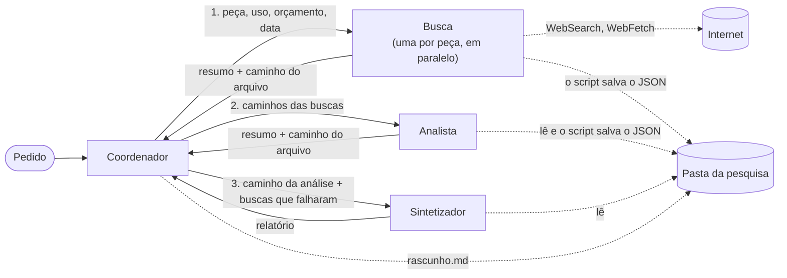

# Hardware research agents

Um pesquisador multi-agente que compara peças de computador e dá a fonte de cada número.

Você escreve o que quer comparar e para quê, por exemplo *"RTX 5060 Ti 16 GB, RX 9060 XT 16 GB e RX 7700 XT 12 GB para jogar em 1440p, orçamento de R$ 3.500"*. Um coordenador divide o trabalho entre agentes de busca, um analista e um sintetizador. O relatório mostra o que as fontes confirmam, o que está em disputa (todos os valores, cada um com fonte e data) e o que ficou sem dado.

Feito com o [Claude Agent SDK](https://github.com/anthropics/claude-agent-sdk-python) para Python, com o Claude Haiku 5.5 em todos os agentes. O relatório sai em português, com preço em reais.

[Read in English](README.md)

## Como funciona



- **Coordenador:** lê o pedido e chama uma busca por peça, depois o analista e depois o sintetizador. Não acessa a internet, e o único arquivo que pode mexer é o rascunho.
- **Busca** (uma por peça, todas ao mesmo tempo): usa WebSearch e WebFetch e devolve achados em JSON, cada um com afirmação, trecho citado, link e data de publicação. Também lista as lacunas e devolve um erro estruturado quando algo falha.
- **Analista:** lê os arquivos das buscas e põe cada peça e critério em um grupo: confirmado, em disputa ou sem dado.
- **Sintetizador:** lê a análise e escreve o relatório.

Cada pesquisa ganha uma pasta:

```
rascunho.md          o rascunho do coordenador: plano, arquivos, falhas
buscas/1-<peça>.json o que cada busca devolveu
analise.json         o que o analista devolveu
relatorio.md         o relatório final, com a seção de cobertura
```

### Decisões

- **Os resultados passam por arquivo, não pela conversa.** Quando o coordenador repassava o JSON de um agente para o outro, ele perdia campos e trechos, mesmo dizendo que tinha copiado tudo. Agora um hook salva a resposta de cada agente na pasta da pesquisa e troca o que o coordenador vê por uma linha: o caminho e a contagem de achados.
- **O código exige o formato.** Um hook `SubagentStop` confere o JSON da busca e do analista antes de eles terminarem. Ele também barra um critério que esteja ao mesmo tempo confirmado e em disputa. Se algo estiver errado, o agente recebe a lista de problemas e tem mais uma chance.
- **Os limites ficam nos hooks.** O coordenador não pesquisa na internet. Cada busca tem 3 pesquisas, 4 páginas abertas e 90 segundos. O coordenador só mexe no rascunho, e os outros agentes só leem arquivos da pasta da pesquisa.
- **Uma falha não para a pesquisa.** A busca que falha devolve o que achou e um erro estruturado, e as outras seguem. O script escreve a seção de cobertura a partir do que aconteceu: tempo esgotado, erro da API, limite de voltas e o campo `error`. Assim o relatório não depende de o modelo lembrar de contar a falha.
- **O script confere o que o modelo não garante:** se todo link do relatório veio de uma busca, se toda disputa da análise chegou ao relatório e se o número de cada valor aparece no trecho citado.
- **A pesquisa avisa cada passo, e o terminal e a página mostram esses avisos cada um do seu jeito.**

Notas de arquitetura: [docs/arquitetura.md](docs/arquitetura.md).

## A tela

O `tela.py` abre uma página em `127.0.0.1`. Nela você digita o pedido e acompanha os agentes trabalhando:
- os passos do coordenador;
- um card por busca, com o que ela pesquisa e as páginas que abre;
- as ferramentas barradas;
- depois, a análise, o relatório, o custo e as conferências.

Fechar a aba cancela a pesquisa. O servidor só escuta na sua máquina, recusa pedidos de outros sites e roda uma pesquisa por vez.

## Resultados

**Exemplo:** em [exemplos/gpus-1440p](exemplos/gpus-1440p) está uma pesquisa completa comparando três placas de vídeo para 1440p, com o rascunho, os três arquivos de busca, a análise e o [relatório](exemplos/gpus-1440p/relatorio.md).

**Conferência das citações.** Abri cada página citada nesse relatório e procurei cada valor (16 citações):

| Resultado | Citações |
|---|---|
| A página existe e diz o valor | 13 de 16 (81%) |
| Não deu para conferir: o site não abriu (1) ou o preço veio de uma versão antiga da página, vista só no resultado de busca (2) | 3 de 16 |

Os trechos citados são menos fiéis que os valores. Dos 13 valores confirmados:
- 5 trechos são literais;
- 4 reorganizam o layout da página, mas mantêm o número;
- 3 são paráfrases ou traduções;
- 1 é da página certa, mas da frase errada: o tamanho da memória citado com uma frase sobre núcleos CUDA.

O WebFetch passa cada página por um modelo antes de o agente ler, e isso explica a maior parte das paráfrases. A conferência automática de trechos do script apontou exatamente essa frase errada (15 de 16 passaram). Outro ponto: um valor está certo, mas vem de testes vazados, e o relatório não diz isso.

**Custo e tempo:** cerca de US$ 0,11 a 0,15 por pesquisa com três peças, medido em quatro rodadas reais, e de 2 a 3 minutos com as buscas em paralelo. Cada pesquisa tem um teto de US$ 0,60.

## Como rodar

Você precisa do Python 3.10+ e da sua própria chave da API da Anthropic. Cada pesquisa é cobrada nela.

```bash
git clone https://github.com/petrecaLeo/hardware-research-agents.git
cd hardware-research-agents
python -m venv .venv && source .venv/bin/activate
pip install -r requirements.txt
cp .env.example .env   # depois coloque a sua chave no .env
python tela.py         # abre http://127.0.0.1:8000
```

Ou rode pelo terminal:

```bash
python pesquisar.py "Compare os SSDs Kingston NV3 1 TB, WD Blue SN5000 1 TB e Crucial P310 1 TB para jogos. Meu orçamento é R$ 500."
python pesquisar.py --sequencial       # uma busca por vez, para comparar o tempo
python pesquisar.py --simular-timeout  # a primeira busca expira, para ver a cobertura parcial
```

## Estrutura

```
pesquisar.py        ponto de entrada no terminal
tela.py             servidor local da página
web/                a página (HTML, CSS e JavaScript, sem build)
researcher/
  coordinator.py    roda a pesquisa e transforma as mensagens do SDK em eventos
  agents.py         definição dos subagentes
  prompts/          um prompt por agente
  guards.py         limites de internet (hook)
  handoff.py        salva os resultados em arquivo e resume para o coordenador (hooks)
  contracts.py      contratos de JSON (hook)
  coverage.py       seção de cobertura, a partir do que aconteceu
  report.py         conferências do relatório: links, disputas, trechos
  progress.py       eventos e tempos
  terminal.py       imprime os eventos
  cost.py           custo por modelo
docs/arquitetura.md notas de arquitetura
exemplos/           pesquisa de exemplo
```

## Limitações

- O Haiku 5.5 deixa o custo baixo, mas os trechos que ele cita muitas vezes são paráfrases. O script confere os números, não o texto.
- Os preços mudam todo dia. Cada fonte traz a data de publicação, ou a data da consulta quando a página não mostra data.
- Alguns sites bloqueiam acesso automático (HTTP 403). O relatório lista esses casos na seção de cobertura.
