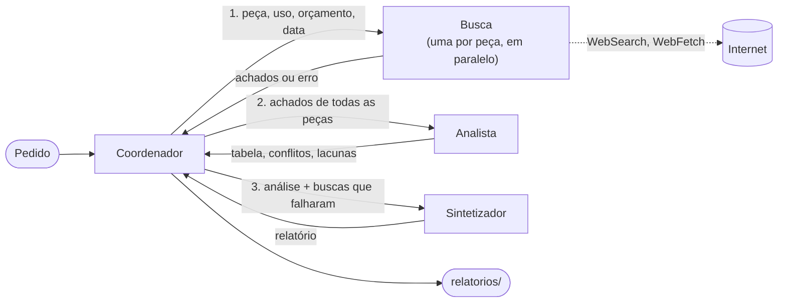

# Arquitetura

Um coordenador e três tipos de subagente. Os subagentes não conversam entre si: tudo passa pelo coordenador (modelo "hub-and-spoke").

Exemplo de pedido: "RTX 5060 x RX 9060 XT x Arc B580, jogos em 1440p, até R$ 2.500".

## Contratos

Todo subagente começa do zero: não vê a conversa do coordenador. O que ele precisa saber tem que estar no pedido que recebe.

### Coordenador

- **Recebe:** o pedido do usuário, em texto livre.
- **Faz:** separa as peças, manda uma busca por peça ao mesmo tempo, passa os achados ao analista e depois a análise ao sintetizador. Se uma busca falhar, segue com as outras peças, sem repetir a busca.
- **Ferramentas:** só a de chamar subagente (`Agent`). Mais tarde, ler e escrever o arquivo de rascunho.
- **Devolve:** o relatório final. Quem salva em `relatorios/` é o script, não o agente.

### Busca

Uma definição só, chamada uma vez por peça.

- **Recebe:** a peça, o uso, o orçamento, a data de hoje e o que procurar (especificações, consumo, preço em reais, desempenho no uso pedido).
- **Ferramentas:** `WebSearch` e `WebFetch`, com no máximo 3 buscas e 90 segundos.
- **Devolve:** um objeto JSON com `part` (a peça), `findings` (os achados), `gaps` (o que procurou e não achou) e `error`. Cada achado tem:

  | Campo | O que é |
  |---|---|
  | `claim` | a afirmação, em uma frase |
  | `quote` | o trecho da fonte que sustenta a afirmação |
  | `url` | o endereço da fonte |
  | `published_at` | a data de publicação da fonte, ou `null` se a página não mostra |

  `error` é `null` quando deu tudo certo. Quando uma falha deixou parte do pedido sem pesquisar, traz `attempted` (o que tentou), `failed` (o que falhou) e `retryable` (se dá para tentar de novo), e a busca devolve junto os achados que já tinha. Lacuna e erro são coisas diferentes: lacuna é "pesquisei e não achei"; erro é "não consegui pesquisar".

### Analista

- **Recebe:** os achados de todas as peças, o uso e o orçamento.
- **Ferramentas:** nenhuma.
- **Devolve:** um objeto JSON com `criteria` (de 4 a 6 critérios, sempre com o preço), `rows` (uma linha por peça e critério, com o valor e os quatro campos do achado de onde veio), `conflicts` (fontes que discordam, com todos os valores) e `gaps` (dados que faltaram).

### Sintetizador

- **Recebe:** o uso, o orçamento, o JSON do analista, em que cada valor já traz a sua fonte, e as buscas que falharam.
- **Ferramentas:** nenhuma.
- **Devolve:** o relatório em Markdown: recomendação para o uso pedido, tabela, achados "confirmados" e "em disputa" (cada um com fonte e data) e lista de fontes. A seção de cobertura por peça quem acrescenta é o script.

## Decisões

- **Só a busca acessa a internet.** Analista e sintetizador trabalham só com o que recebem, então toda afirmação do relatório volta a uma fonte.
- **O coordenador não busca nem escreve o relatório.** Se pudesse, faria tudo sozinho e a divisão perderia o sentido.
- **A ordem é fixa:** busca, análise, síntese. O coordenador decide o que fazer quando uma busca falha ou falta um dado.
- **O formato é exigido pelo código, não só pedido no prompt.** Um hook confere o JSON da busca e do analista antes de eles terminarem e, se faltar campo, url ou trecho, devolve os problemas para o subagente corrigir (uma vez).
- **O script confere o que o modelo não garante:** quantos trechos o coordenador repassou inteiros de um agente para o outro e se algum link do relatório não veio das buscas.
- **Uma falha não para a pesquisa nem passa em silêncio.** A busca resolve sozinha o que der (outra fonte, por exemplo) e devolve um erro estruturado quando não consegue. O coordenador segue com as outras peças. O relatório ganha uma seção de cobertura por peça ("cobertura completa", "parcial: ..." ou "sem dados: ..."), escrita pelo script a partir do que aconteceu: tempo esgotado no guarda, campo `error` da busca e os avisos do Claude Code quando um subagente cai por erro da API ou para no limite de voltas. Assim a cobertura não depende de o modelo lembrar de anotar a falha.
- **Todos os agentes usam o Claude Haiku 5.5**, o modelo mais barato.
- **O relatório sai em português**, com preço em reais. A busca pode usar fontes em inglês para especificações e testes.

## Por que não um agente só

1. **Contexto separado:** cada busca lê várias páginas. Num agente só, as páginas das três peças se misturam e enchem o contexto. Com subagentes, cada um lê as suas e devolve só os achados.
2. **Foco:** cada agente tem um prompt curto, uma tarefa e só as ferramentas de que precisa. Fica mais fácil testar e trocar um sem mexer nos outros.
3. **Paralelo e falha isolada:** as três buscas rodam ao mesmo tempo. Se uma falha, as outras seguem, e o relatório diz o que ficou de fora.
