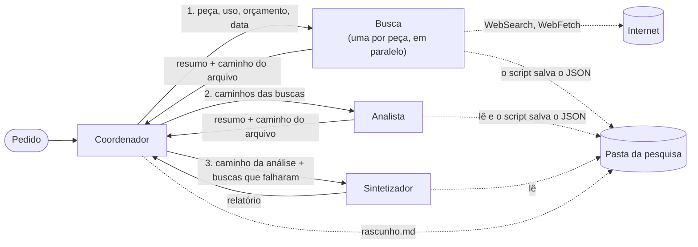

# Arquitetura

Um coordenador e três tipos de subagente. Os subagentes não conversam entre si: tudo passa pelo coordenador (modelo "hub-and-spoke").



Cada pesquisa ganha uma pasta em `relatorios/<data-hora>/`:

```
rascunho.md          o progresso, anotado pelo coordenador
buscas/1-<peça>.json o que cada busca devolveu
analise.json         o que o analista devolveu
relatorio.md         o relatório final, com a seção de cobertura
```

Exemplo de pedido: "RTX 5060 x RX 9060 XT x Arc B580, jogos em 1440p, até R$ 2.500".

## Contratos

Todo subagente começa do zero: não vê a conversa do coordenador. O que ele precisa saber tem que estar no pedido que recebe.

### Coordenador

- **Recebe:** o pedido do usuário, em texto livre.
- **Faz:** separa as peças, manda uma busca por peça ao mesmo tempo, passa os caminhos dos arquivos das buscas ao analista e depois o da análise ao sintetizador. Se uma busca falhar, segue com as outras peças, sem repetir a busca. Anota o progresso em `rascunho.md` depois de cada etapa.
- **Ferramentas:** `Agent`, para chamar os subagentes, e `Read`, `Write` e `Edit`, só no `rascunho.md`.
- **Devolve:** o relatório final. Quem salva em `relatorios/` é o script, não o agente.

### Busca

Uma definição só, chamada uma vez por peça.

- **Recebe:** a peça, o uso, o orçamento, a data de hoje e o que procurar (especificações, consumo, preço em reais, desempenho no uso pedido).
- **Ferramentas:** `WebSearch` e `WebFetch`, com no máximo 3 buscas e 90 segundos.
- **Devolve:** um objeto JSON com `part` (a peça), `findings` (os achados), `gaps` (o que procurou e não achou) e `error`. Cada achado tem:

  | Campo | O que é |
  |---|---|
  | `claim` | a afirmação, em uma frase |
  | `quote` | o trecho da fonte que sustenta a afirmação |
  | `url` | o endereço da fonte |
  | `published_at` | a data de publicação da fonte, ou `null` se a página não mostra |

  `error` é `null` quando deu tudo certo. Quando uma falha deixou parte do pedido sem pesquisar, traz `attempted` (o que tentou), `failed` (o que falhou) e `retryable` (se dá para tentar de novo), e a busca devolve junto os achados que já tinha. Lacuna e erro são coisas diferentes: lacuna é "pesquisei e não achei"; erro é "não consegui pesquisar".

### Analista

- **Recebe:** o pedido do usuário e os caminhos dos arquivos das buscas.
- **Ferramentas:** `Read`, só na pasta da pesquisa.
- **Devolve:** um objeto JSON com `criteria` (de 4 a 6 critérios, sempre com o preço) e três grupos. Cada peça e critério fica em um grupo só:
  - `rows`, **confirmado**: um valor que nenhum achado contradiz, com os quatro campos do achado de onde veio;
  - `conflicts`, **em disputa**: achados que dão valores diferentes para a mesma coisa, com todos os valores, cada um com trecho, fonte e data;
  - `gaps`, **sem dado**: nenhum achado cobre.

  Valores que medem coisas diferentes (TDP oficial × consumo medido) não estão em disputa: viram critérios separados. Preço de lojas diferentes também não. Preço de datas diferentes, sim, e a data de cada um ajuda a explicar a diferença.

### Sintetizador

- **Recebe:** o pedido do usuário, o caminho da análise e as buscas que falharam.
- **Ferramentas:** `Read`, só na pasta da pesquisa.
- **Devolve:** o relatório em Markdown, com as seções Recomendação, Confirmado (uma tabela só com os valores confirmados), Em disputa (todos os valores, cada um com fonte e data), Lacunas e Fontes. Cada fonte traz a data de publicação ou, se a página não mostra, a data da consulta. A seção de cobertura por peça quem acrescenta é o script.

## Decisões

- **Só a busca acessa a internet.** Analista e sintetizador trabalham só com o que recebem, então toda afirmação do relatório volta a uma fonte.
- **O coordenador não busca nem escreve o relatório.** Se pudesse, faria tudo sozinho e a divisão perderia o sentido.
- **A ordem é fixa:** busca, análise, síntese. O coordenador decide o que fazer quando uma busca falha ou falta um dado.
- **O formato é exigido pelo código, não só pedido no prompt.** Um hook confere o JSON da busca e do analista antes de eles terminarem. Se faltar campo, url ou trecho, ou se o mesmo critério estiver confirmado e em disputa ao mesmo tempo, devolve os problemas para o subagente corrigir (uma vez).
- **Os resultados passam por arquivo, não pela conversa.** Quando o coordenador copiava os JSON de um agente para o outro, ele perdia campos e trechos no caminho, mesmo dizendo que tinha copiado tudo. Agora o script salva o que a busca e o analista devolvem, e um hook troca a resposta inteira por um resumo com o caminho do arquivo. O coordenador não tem o que copiar, e a conversa dele fica curta.
- **O coordenador anota o progresso num rascunho.** O `rascunho.md` guarda o pedido, o plano, os arquivos de cada etapa e o que falhou. Se a conversa do coordenador for resumida para caber no contexto, o estado continua no arquivo. Ele também mostra, depois, o que o coordenador entendeu em cada etapa.
- **O script confere o que o modelo não garante:** se algum link do relatório não veio das buscas e se todo item em disputa da análise chegou ao relatório.
- **Uma falha não para a pesquisa nem passa em silêncio.** A busca resolve sozinha o que der (outra fonte, por exemplo) e devolve um erro estruturado quando não consegue. O coordenador segue com as outras peças. O relatório ganha uma seção de cobertura por peça ("cobertura completa", "parcial: ..." ou "sem dados: ..."), escrita pelo script a partir do que aconteceu: tempo esgotado no guarda, campo `error` da busca e os avisos do Claude Code quando um subagente cai por erro da API ou para no limite de voltas. Assim a cobertura não depende de o modelo lembrar de anotar a falha.
- **Todos os agentes usam o Claude Haiku 5.5**, o modelo mais barato.
- **O relatório sai em português**, com preço em reais. A busca pode usar fontes em inglês para especificações e testes.

## Por que não um agente só

1. **Contexto separado:** cada busca lê várias páginas. Num agente só, as páginas das três peças se misturam e enchem o contexto. Com subagentes, cada um lê as suas e devolve só os achados.
2. **Foco:** cada agente tem um prompt curto, uma tarefa e só as ferramentas de que precisa. Fica mais fácil testar e trocar um sem mexer nos outros.
3. **Paralelo e falha isolada:** as três buscas rodam ao mesmo tempo. Se uma falha, as outras seguem, e o relatório diz o que ficou de fora.
